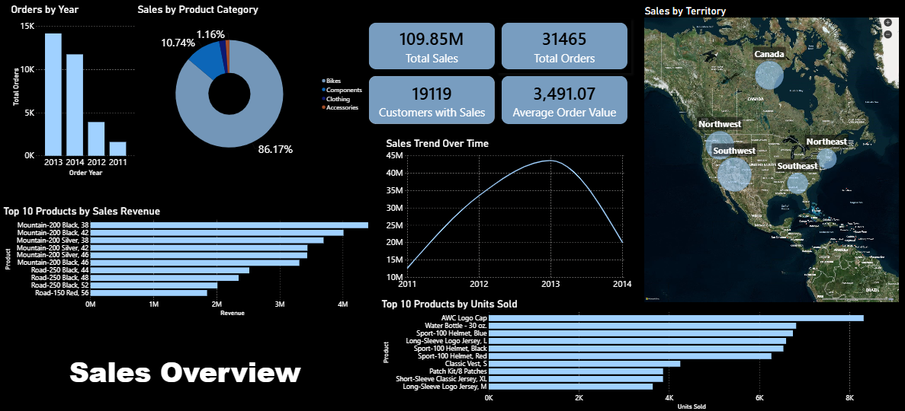

# AdventureWorks Sales Analysis

A sales analysis project using **SQL Server, T-SQL, and Power BI** to explore sales performance, product trends, customer behavior, territory performance, and discount patterns using the AdventureWorks2022 database.

## Project Overview

The project analyzes AdventureWorks2022 sales data to understand business performance and identify patterns across orders, products, customers, territories, and discounts.

The work combines SQL-based data exploration, validation, and analysis with an interactive Power BI dashboard that presents the main sales performance indicators.

## Business Questions

The analysis focuses on six areas:

1. **Sales Performance:** How did sales performance change over the observed period?
2. **Product Performance:** Which products generated the highest revenue and sales volume?
3. **Product Categories:** How are sales distributed across product categories and subcategories?
4. **Customer Analysis:** How is revenue distributed across customers, and how concentrated are sales?
5. **Territory Performance:** How do sales results differ across territories?
6. **Discount Analysis:** How frequently are discounts applied, and how does discount usage vary across products?

## Dataset Overview

The analysis uses the AdventureWorks2022 database, focusing on its sales and product-related tables.

| Metric | Value |
|---|---:|
| Sales order lines | 121,317 |
| Sales orders | 31,465 |
| Customers in master table | 19,820 |
| Customers with recorded sales | 19,119 |
| Products in product table | 2,016 |
| Distinct products sold | 266 |
| Sales territories | 10 |

**Observed sales period:** May 31, 2011 – June 30, 2014.

The dataset includes partial years at the beginning and end of the observed period. Therefore, 2011 and 2014 should not be interpreted as complete calendar years when comparing annual sales.

## Tools & Technologies

- **Database:** SQL Server
- **Querying & Analysis:** T-SQL
- **Data Visualization:** Power BI Desktop
- **Documentation:** Markdown

## Power BI Dashboard

The dashboard provides an overview of sales performance, including total sales, orders, customers with sales, average order value, yearly sales trends, top-performing products, product category distribution, and territory performance.



[View or download the Power BI dashboard](dashboard/sales_dashboard.pbix)

## Key Findings

- Total recorded sales amounted to approximately **109.85 million** across **31,465 orders**.
- The average order value was approximately **3,491.07**.
- The 2013 calendar year recorded approximately **43.62 million** in sales.
- The available 2014 data covers January through June only; it does not represent a full-year result.
- Customer sales are concentrated among a relatively small portion of customers.
- Discount usage varies across product subcategories, indicating that discounts are not distributed uniformly across the product range.

## Repository Structure

```text
AdventureWorks-Sales-Analytics/
│
├── README.md
├── .gitignore
│
├── dashboard/
│   └── sales_dashboard.pbix
│
├── images/
│   └── AdventureWork_Sales_Dashboard.png
│
├── documentation/
│   ├── business_understanding.md
│   ├── data_understanding.md
│   ├── data_validation.md
│   └── insights.md
│
└── sql/
    ├── 01_data_exploration.sql
    ├── 02_data_validation.sql
    └── 03_sales_analysis.sql
```

## Project Status

**Completed:** Data exploration, data validation, SQL sales analysis, business insights documentation, and Power BI dashboard development.

## Notes & Limitations

- The analysis is descriptive and identifies patterns in the available data; it does not establish causal relationships.
- Sales revenue should not be interpreted as profit.
- Discount analysis is performed at the sales-line level because an order may contain multiple discount rates.
- Annual comparisons involving 2011 or 2014 require caution because both years are only partially represented in the dataset.